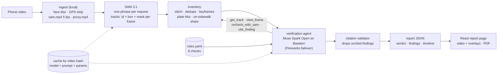

# AccessWalk

**Know before you go.** Film the walk from the bus stop or parking spot to the entrance on a phone.
AccessWalk turns that video into an accessibility report for wheelchair users: likely barriers along
the route, each tied to a tracked object and the video frame it rests on.

It is a pre-trip and pre-audit screening tool. It does **not** certify ADA compliance and it is not
real-time navigation. Every finding says "likely barrier" and asks you to verify on site; anything
judged from depth, height or slope in a phone video is marked `verify_manually`.

Built solo for the Meta Global AI Developer Hackathon (indie track).

## What it does

1. **Upload** a 15 s to 2 min walkthrough (`.mp4`/`.mov` from a phone, held upright).
2. **Privacy first, locally:** faces are detected and blurred on every source frame (OpenCV YuNet)
   before any frame leaves the machine. GPS and all other metadata are stripped from every derived
   file. License plates are blurred in everything published, using SAM's own `license plate` tracks.
3. **Track:** SAM 3.1 segments and tracks 14 noun phrases across the clip (bins, cars, poles,
   construction barriers, traffic barrels, raised slabs, curbs, tactile paving, sidewalk, stairs,
   handrails, doorknobs, vegetation, plates). Each object keeps one identity across frames.
4. **Inventory:** tracks are stitched, de-duplicated across phrases, given a best keyframe, and
   measured against the sidewalk mask (how much of an object stands on the walkway).
5. **Verify (agent):** an open-weight Muse Spark Open agent reviews the inventory against 8 rule-based
   checks, with tools to read a track, look at frames, re-run SAM with a new phrase on a time window,
   and cite a finding. A finding without a valid track and frame citation is dropped.
6. **Report:** a route verdict, findings with their cited frames and mask overlays, a timeline over
   the blurred video, and a PDF export.

### The 8 checks
Sidewalk obstruction · surface damage (heaved or broken slabs) · missing curb ramp · sidewalk ends ·
steps without a ramp · missing handrail · round doorknob · narrow passage.
Each check's recall and precision are in [Evaluation](#evaluation), weak ones included.

## Architecture



| Piece | Where |
|---|---|
| Ingest, face blur, metadata strip | `backend/accesswalk/ingest.py` |
| SAM 3.1 client and Python parser for its token output | `backend/accesswalk/sam.py`, `sam_parse.py` |
| Inventory, plate blur | `backend/accesswalk/inventory.py`, `plates.py` |
| Agent loop, tools, provider failover | `backend/accesswalk/agent.py`, `llm.py` |
| Rules and citation validator | `backend/accesswalk/rules.yaml`, `validator.py` |
| Route verdict | `backend/accesswalk/verdict.py` |
| API (upload, job status, reports, media) | `backend/accesswalk/api.py`, `jobs.py` |
| Report contract (pydantic → JSON Schema) | `backend/accesswalk/schemas.py`, `frontend/src/schema/` |
| Report UI | `frontend/` (React + Vite) |
| Eval harness and baseline | `eval/`, `backend/accesswalk/scoring.py`, `baseline.py` |
| Deploy | `deploy/modal_app.py`, `scripts/deploy_bundle.py` |

### Meta AI tooling
- **SAM 3.1** (Meta Model API): video tracking with stable object identity, which is what makes
  route-level reasoning possible (one bin seen across 40 frames is one bin).
- **Muse Spark Open** (open weights, served by Baseten, same model on Fireworks as failover): the
  verification agent. Every model call logs the provider and the model that served it.
- **Muse Spark 1.3**: only as the no-tools baseline in the eval (the whole raw video in one prompt).

## Evaluation

22 clips filmed on a Pixel 8 Pro (746 s, 28 labelled barriers, 221 s labelled clean), split before any
tuning:
- **Development set:** the 11 Oct-29 clips (15 barriers). Rules and prompts were tuned on these only.
- **Held-out test set:** the 11 Oct-27 clips (13 barriers: 7 surface damage, 4 narrow passage, 2
  sidewalk ends; 126 s clean). Nobody looked at agent output for them while tuning or labelling. The
  final runs on them were made once, after the labels were committed.
- **Shipping rule, fixed before the held-out runs:** ship v2 unless the hybrid v3 beats it by 3 or more
  barriers in recall over all 22 clips, with precision no worse. It did not (14 of 28 against 16 of 28),
  so **v2 ships**.

Systems:
- **v2 (shipped):** the verification agent (Muse Spark Open on Baseten) over SAM 3.1 tracks, current rules.
- **v1:** the same agent with the Oct-30 rules.
- **v3 (not shipped, branch `hybrid-proposals`):** Muse Spark Open first watches the blurred video and
  proposes candidate barriers; the agent then verifies each one against the tracks and cites as usual.
- **Proposer alone:** those Muse Spark Open proposals, unverified.
- **Baseline:** Muse Spark 1.3 (closed) watches the blurred video once. No tools, no tracking.

### Held-out test set (Oct-27, 11 clips, 13 barriers)

| System | Recall | Precision | Recall, merged width | Precision, merged width | Review cost |
|---|---|---|---|---|---|
| **v2 agent (shipped)** | **54% (7/13)** | **90% (9/10)** | 54% | 90% | $1.67 |
| v1 agent | 46% (6/13) | 86% (6/7) | 46% | 86% | $1.32 |
| v3 hybrid | 54% (7/13) | 88% (7/8) | 54% | 88% | $1.70 |
| Proposer alone (Muse Spark Open, video) | 62% (8/13) | 53% (8/15) | 62% | 59% | $0.17 |
| Baseline (Muse Spark 1.3, video) | 69% (9/13) | 90% (9/10) | 69% | 91% | $0.18 |

### All 22 clips (28 barriers)

| System | Recall | Precision | Recall, merged width | Precision, merged width | Review cost |
|---|---|---|---|---|---|
| **v2 agent (shipped)** | **57% (16/28)** | **90% (18/20)** | 61% | 90% | $3.48 |
| v1 agent | 54% (15/28) | 88% (15/17) | 61% | 89% | $2.84 |
| v3 hybrid | 50% (14/28) | 88% (14/16) | 57% | 89% | $3.75 |
| Proposer alone (Muse Spark Open, video) | 64% (18/28) | 58% (18/31) | 71% | 63% | $0.34 |
| Baseline (Muse Spark 1.3, video) | 64% (18/28) | 95% (18/19) | 68% | 95% | $0.41 |

Per check, all 22 clips, strict (recall and precision):

| Check | Barriers | v2 agent | Baseline |
|---|---|---|---|
| Sidewalk obstruction | 8 | 6/8 · 100% | 6/8 · 100% |
| Narrow passage | 8 | 4/8 · 83% | 4/8 · 100% |
| Surface damage | 7 | 3/7 · 100% | 4/7 · 100% |
| Sidewalk ends | 3 | 1/3 · 100% | 2/3 · 100% |
| Steps without ramp | 1 | 1/1 · 50% | 1/1 · 50% |
| Missing handrail | 1 | 1/1 · 100% | 1/1 · 100% |
| Missing curb ramp, round doorknob | 0 | not measured | not measured |

How to read this:
- **The no-tools baseline has the best recall** (69% against 54% held out) at about the same
  precision, for about a tenth of the review cost and with no SAM. The agent does not win on recall.
  What it adds is grounding: every agent finding cites a SAM track and a frame where that object is
  boxed, checked by the validator, so the report shows the object. A baseline finding is a timestamp
  and a sentence that nothing checks.
- **Precision rests on few false positives.** Only 221 s are labelled clean, and a finding outside every
  labelled range is not scored. One held-out false positive (steps without a ramp) is shared by all five
  systems.
- **Weakest checks:** surface damage and sidewalk ends. No clip has a labelled curb ramp or doorknob,
  so those two checks are not measured.
- **The open-weight proposer finds more but is wrong often** (58% precision). In the hybrid, the agent
  rejects most of its mistakes but also some correct proposals, and ends below v2.
- **The sample is small** (28 barriers). Gaps of 1-2 barriers are within the run-to-run variation seen
  on the development set.

Review cost is the reviewing model's calls on those clips (for v3, agent plus proposer). The agent
systems also pay for SAM 3.1 tracking: $4.66 for the held-out clips and $10.44 for all 22 (14 phrases at
5 fps). The baselines need no SAM.

Method (`eval/run_eval.py`, no network, no spend):
- Ground truth per clip in `data/annotations/`: barrier check, time range, severity, clean stretches, and
  checks that cannot occur on the clip.
- A finding matches a barrier of the same check within ±1 s and hits at most one barrier, so
  overlapping barriers need a finding each. A finding in a clean stretch, or of a check marked not
  applicable, is a false positive. Anything else is not scored.
- **Merged width** scores sidewalk obstruction and narrow passage as one check, since whether a parked
  car or a pole "blocks" or "narrows" the walk is a judgement call.
- Every run is frozen before scoring (`scripts/freeze_run.py`: read-only copies plus a committed
  manifest of hashes in `eval/runs/`).

```
micromamba run -n accesswalk python eval/run_eval.py --clips PXL_20261027_,PXL_20261028_ \
  --system agent:v2+v2-heldout --system agent:v1 --system agent:v3+v3-heldout \
  --system baseline:proposer-open-v1+proposer-open-heldout --system baseline:baseline-v1
```
(drop `--clips` for all 22 clips; add `--merge-width` for the merged scores)

## Privacy
- Faces are blurred locally before any frame goes to a model. Raw videos never leave the machine and
  are never committed; on the deployed server, raw uploads are deleted when their job ends.
- Metadata (including the phone's GPS) is stripped from every derived file (`-map_metadata -1`).
- Published frames and the report video have faces and license plates blurred.
- The API serves only `proxy.mp4`, rendered frames and mask PNGs, matched against a fixed pattern.

## Cost and caching
Every model call is cached by (video hash, model, prompt, params) under `data/cache/`, and logged with
its provider, model and usage to `data/out/usage.jsonl`. Re-runs are free. The 24 s demo clip costs
about $0.43 end to end (SAM ~$0.29 for 14 phrases at 5 fps, agent ~$0.13). Each job has a $1 cap checked
before any paid call; the deployed server also has daily and total caps.

## Run it locally

Windows + micromamba (`environment.yml`; `setup.ps1` creates the `accesswalk` env).

```
copy .env.example .env        # fill in MODEL_API_KEY, BASETEN_*, FIREWORKS_*
micromamba run -n accesswalk python scripts/check_setup.py
micromamba run -n accesswalk uvicorn accesswalk.api:app --app-dir backend --port 8010
micromamba run -n accesswalk npm --prefix frontend ci
micromamba run -n accesswalk npm --prefix frontend run dev:http
```

Tests: `micromamba run -n accesswalk python -m pytest backend/tests` and `npm --prefix frontend test`
(no network; recorded fixtures).

### Demo route (always runs, $0)
The demo route is `PXL_20261029_230808382` (24 s, sidewalk to a flight of steps). Its SAM, agent and
recheck calls are all cached, so uploading it, or its GPS-stripped copy
(`ffmpeg -i in.mp4 -map 0:v:0 -map 0:a:0? -c copy -map_metadata -1 out.mp4`), completes in a few
seconds with no paid call. This was checked with every model host unreachable. "Try a sample route"
on the upload page opens its finished report with no upload at all (`VITE_SAMPLE_REPORT_ID`).

## Deploy (Modal)
Live: https://rafi-tahmid--accesswalk-web.us-east.modal.run (sample route and reports; uploads need the passcode).

One Modal app serves the API and the built UI on one URL, on CPU only, scaling to zero. It is public
and read-only: sample route, reports, blurred media. Uploads need a passcode, and they stop once the
spend caps are used ($1 per job, $5 a day, $10 in total). The data volume holds blurred media and
model caches only: no raw video, no `sam.mp4`, no face-only proxy.

```
modal token new
modal secret create accesswalk --from-dotenv .env
modal secret create accesswalk-upload ACCESSWALK_UPLOAD_PASSCODE=<16+ random characters>
cd frontend && VITE_SAMPLE_REPORT_ID=<report_id> npx vite build --mode http && cd ..
micromamba run -n accesswalk python scripts/deploy_bundle.py PXL_20261029_230808382 --twin data/out/demo/PXL_20261029_230808382.mp4 --upload
micromamba run -n accesswalk modal run deploy/modal_app.py --video data/out/demo/PXL_20261029_230808382.mp4
micromamba run -n accesswalk modal deploy deploy/modal_app.py
```
The `modal run` step replays the demo upload on the server with no keys and every model host
blocked; it passes only if everything comes from the cache. The laptop setup above stays the
offline fallback for the live demo.

## Limitations
- Phone video flattens depth: heights, slopes and clear widths are estimates, always marked for
  manual checks. A MapAnything spike (metric 3D from frames) passed on width repeatability only,
  without a tape-measure check yet, so no geometry tool ships.
- SAM does not localize ramps or curb ramps directly; the agent judges them from stairs, handrail,
  curb and tactile-paving tracks and their keyframes.
- Outdoor routes only, filmed by one person on one phone. The clips are silent, so narration
  (location tags from Muse Voice Transcribe) was dropped.

## Built during the hackathon
Everything in this repo was written during the build window, starting with the first commit on
Oct 28, 2026 (see `git log`), with no imported code. The day-by-day task list and session log are in
`PROGRESS.md`; the working rules are in `CLAUDE.md`. Code was written with Claude Code (pipeline and
frontend as two parallel sessions). The videos were filmed for this project; raw footage, audio and
unblurred frames are never committed.
