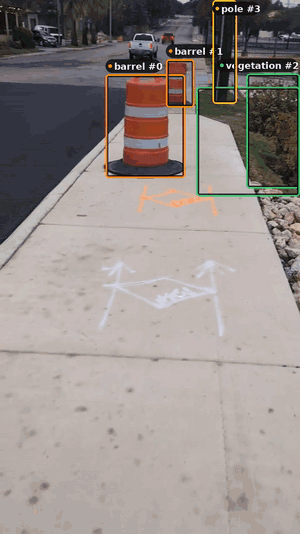
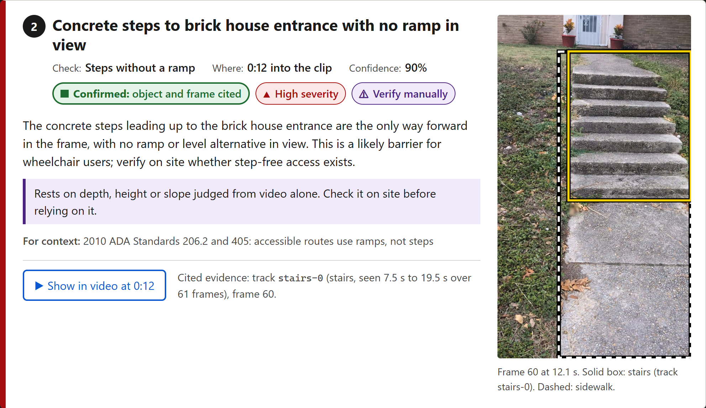
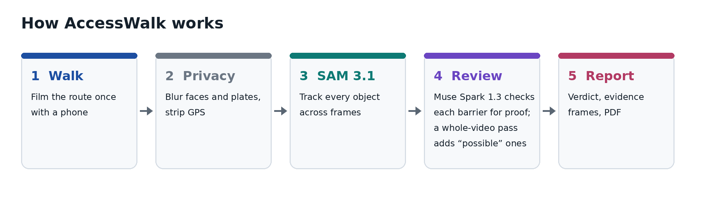
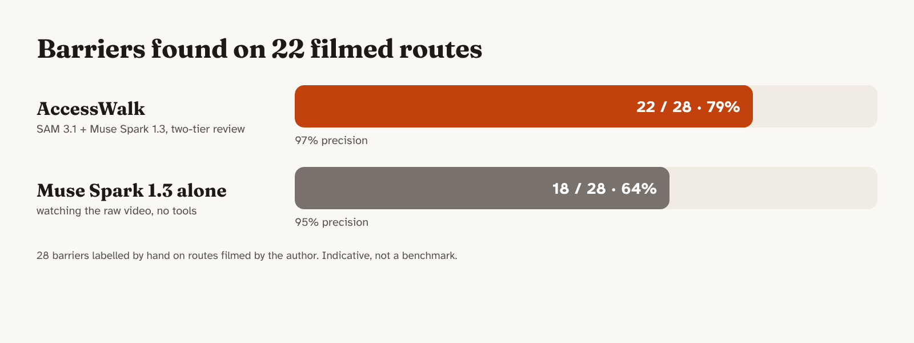
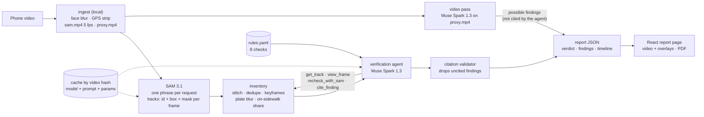

# AccessWalk

**Know before you go.** Film the walk from the bus stop or parking spot to the entrance on a phone.
AccessWalk turns that video into an accessibility report for wheelchair users: the barriers along the
route, each tied to an object SAM 3.1 tracked and the video frame it was seen in.

<!-- MEDIA SLOT 1 · hero GIF: walkthrough with the SAM tracking overlay · file: docs/media/hero.gif
<p align="center"></p>
-->

**Live:** https://rafi-tahmid--accesswalk-web.us-east.modal.run (open "Try a sample route").
Built solo for the Meta Global AI Developer Hackathon (indie track).

## What it does

You upload a walkthrough. You get back a route verdict and a list of barriers: a bin on the sidewalk,
a heaved slab, a flight of steps with no ramp or handrail. Each one shows the frame it was seen in, the
tracked object, and a short note on why it matters.

- **Confirmed** barriers are cited to a SAM track and a frame, and checked by a validator.
- **Possible** barriers were seen in the video but not tied to a track; they are marked "check on site"
  and never decide the verdict on their own.

It checks 8 things: sidewalk obstruction · surface damage (heaved or broken slabs) · missing curb ramp ·
sidewalk ends · steps without a ramp · missing handrail · round doorknob · narrow passage.

It is a screening tool for planning a trip or an audit. It does not certify ADA compliance and it is
not real-time navigation. Anything judged from depth, height or slope in a phone video is marked
`verify_manually`.

<!-- MEDIA SLOT 4 · two columns: what SAM tracks / what the report says (same moment) · files: docs/media/sam-tracks.png, docs/media/report-finding.png
<table>
  <tr>
    <th width="50%">What SAM tracks</th>
    <th width="50%">What the report says</th>
  </tr>
  <tr>
    <td></td>
    <td></td>
  </tr>
</table>
-->

## How it works

<!-- MEDIA SLOT 2 · "how it works" pipeline image · file: docs/media/pipeline.png
<p align="center"></p>
-->

1. **Upload** a 15 s to 2 min walkthrough (`.mp4`/`.mov` from a phone, held upright).
2. **Privacy first, locally:** faces are detected and blurred on every source frame (OpenCV YuNet)
   before any frame leaves the machine. GPS and all other metadata are stripped from every derived
   file. License plates are blurred in everything published, using SAM's own `license plate` tracks.
3. **Track:** SAM 3.1 segments and tracks 14 noun phrases across the clip (bins, cars, poles,
   construction barriers, traffic barrels, raised slabs, curbs, tactile paving, sidewalk, stairs,
   handrails, doorknobs, vegetation, plates). Each object keeps one identity across frames.
4. **Inventory:** tracks are stitched, de-duplicated across phrases, given a best keyframe, and
   measured against the sidewalk mask (how much of an object stands on the walkway).
5. **Verify (agent):** a Muse Spark 1.3 agent reviews the inventory against 8 rule-based checks, with
   tools to read a track, look at frames, re-run SAM with a new phrase on a time window, and cite a
   finding. A finding without a valid track and frame citation is dropped.
6. **Second look (video pass):** Muse Spark 1.3 also watches the blurred video once. Barriers it sees
   that the agent did not cite are added as "possible", marked verify on site.
7. **Report:** a route verdict, findings with their cited frames and mask overlays, a timeline over
   the blurred video, and a PDF export.

## Results

On 22 walkthrough clips with 28 labelled barriers, the two-tier review finds **79% of barriers (22/28)
at 97% precision (31/32)**. Muse Spark 1.3 watching the same blurred video without tracking finds 64%
at 95%. Tracking adds the barriers a single look misses; the video pass adds the ones SAM has no
object for. The clips were filmed and labelled by the author, so the numbers are indicative.

<!-- MEDIA SLOT 3 · results card · file: docs/media/results.png
<p align="center"></p>
-->

All 12 systems compared, per-check notes and the method are in [Evaluation](#evaluation).

## Architecture



| Piece | Where |
|---|---|
| Ingest, face blur, metadata strip | `backend/accesswalk/ingest.py` |
| SAM 3.1 client and Python parser for its token output | `backend/accesswalk/sam.py`, `sam_parse.py` |
| Inventory, plate blur | `backend/accesswalk/inventory.py`, `plates.py` |
| Agent loop, tools, provider switch | `backend/accesswalk/agent.py`, `llm.py` |
| Review stage (two-tier and the other evaluated systems) | `backend/accesswalk/review.py`, `combine.py`, `grounded.py` |
| Rules and citation validator | `backend/accesswalk/rules.yaml`, `validator.py` |
| Route verdict | `backend/accesswalk/verdict.py` |
| API (upload, job status, reports, media) | `backend/accesswalk/api.py`, `jobs.py` |
| Report contract (pydantic → JSON Schema) | `backend/accesswalk/schemas.py`, `frontend/src/schema/` |
| Report UI | `frontend/` (React + Vite) |
| Eval harness and baseline | `eval/`, `backend/accesswalk/scoring.py`, `baseline.py` |
| Deploy | `deploy/modal_app.py`, `scripts/deploy_bundle.py` |

### Meta AI tooling
- **SAM 3.1** (Meta Model API): video tracking with stable object identity, which is what makes
  route-level reasoning possible (one bin seen across 40 frames is one bin).
- **Muse Spark 1.3** (Meta Model API): the verification agent (tool calls over the tracks and frames)
  and the video pass that adds "possible" findings. Every model call logs the provider and the model
  that served it.
- **Muse Spark Open** (open weights on Baseten, Fireworks as failover): the same agent runs on it with
  `ACCESSWALK_REVIEW=open`; it was the first shipped version and is in the eval table.

## Evaluation

### What ships
The **two-tier review**: SAM 3.1 tracks the clip, then two passes with Muse Spark 1.3.
- **Confirmed** findings come from the verification agent: it reads the tracks, looks at frames, can
  re-run SAM on a window, and cites each finding to a track and a frame. The validator drops any
  citation whose track, phrase or frame does not check out.
- **Possible** findings come from Muse Spark 1.3 watching the blurred video once with the 8 check
  questions. Any of them the agent did not already report is added as "possible" (`tier`), always
  marked verify on site, and never decides the route verdict on its own.

### Results (22 clips, 28 labelled barriers)

| System | Recall | Precision | Recall, merged width | Precision, merged width | Review | SAM | Total |
|---|---|---|---|---|---|---|---|
| **Two-tier review (ships)** | **79% (22/28)** | **97% (31/32)** | **82%** | **97%** | $3.62 | $10.45 | $14.07 |
| Ensemble: agent + one-call + video pass | 75% (21/28) | 92% (33/36) | 79% | 92% | $4.83 | $10.45 | $15.28 |
| One call: video + tracks + a still per track | 68% (19/28) | 92% (23/25) | 71% | 92% | $1.21 | $10.44 | $11.65 |
| Video pass alone (Muse Spark 1.3, no tracks) | 64% (18/28) | 95% (18/19) | 68% | 95% | $0.41 | – | $0.41 |
| Video pass alone (Muse Spark Open) | 64% (18/28) | 58% (18/31) | 71% | 63% | $0.34 | – | $0.34 |
| Agent v2 on Muse Spark Open | 57% (16/28) | 90% (18/20) | 61% | 90% | $3.48 | $10.68 | $14.16 |
| One call: video + tracks + 4 stills per track | 57% (16/28) | 90% (18/20) | 61% | 90% | $2.22 | $10.44 | $12.66 |
| Agent v2 on Muse Spark 1.3 (confirmed tier alone) | 54% (15/28) | 94% (15/16) | 54% | 94% | $3.20 | $10.45 | $13.65 |
| Hybrid: video pass proposes, agent verifies (Spark 1.3) | 54% (15/28) | 94% (15/16) | 57% | 94% | $3.93 | $10.54 | $14.47 |
| Agent v1 on Muse Spark Open | 54% (15/28) | 88% (15/17) | 61% | 89% | $2.84 | $10.83 | $13.67 |
| Hybrid on Muse Spark Open | 50% (14/28) | 88% (14/16) | 57% | 89% | $3.75 | $10.68 | $14.43 |
| Agent on Spark 1.3, 24 views, recheck before rejecting | 46% (13/28) | 88% (14/16) | 50% | 88% | $5.40 | $10.73 | $16.13 |

The clips were filmed and labelled by the author (one person, one phone, 746 s of video), so these
numbers are indicative, not a benchmark.

What the table shows:
- The two passes catch different barriers. The agent is strongest on objects SAM tracks well (bins,
  barrels, cars, steps); the video pass adds surface damage and stretches with no tracked object.
  Together they find 22 of 28 barriers with one false positive.
- Giving the agent more frames, more SAM rechecks or the video pass's candidates as hints did not
  raise its recall; keeping the two passes separate did.
- Precision rests on few false positives: 221 s are labelled clean, and a finding outside every labelled
  range is not scored.
- No clip has a labelled curb ramp or round doorknob, so those two checks are not measured.

Review is the reviewing models' calls; SAM is tracking (14 phrases at 5 fps) plus the agent's rechecks.

Method (`eval/run_eval.py`, no network, no spend): ground truth per clip in `data/annotations/` (check,
time range, severity, clean stretches, checks that cannot occur). A finding matches a barrier of the
same check within ±1 s and hits at most one barrier. A finding in a clean stretch, or of a check marked
not applicable, is a false positive; anything else is not scored. **Merged width** scores sidewalk
obstruction and narrow passage as one check. Every run is frozen before scoring
(`scripts/freeze_run.py`: read-only copies plus a manifest of hashes in `eval/runs/`).

```
micromamba run -n accesswalk python eval/run_eval.py --system agent:e4 --system agent:e7 \
  --system agent:e2 --system baseline:baseline-v1 --system agent:v2+v2-heldout [--merge-width]
```
Run ids: e4 two-tier, e7 ensemble, e2/e6 one call, e1 agent on Spark 1.3, e3 hybrid on Spark 1.3,
e5 deeper agent, v1/v2/v3 open-weight agent runs, baseline-v1 and proposer-open video passes.

## Privacy
- Faces are blurred locally before any frame goes to a model. Raw videos never leave the machine and
  are never committed; on the deployed server, raw uploads are deleted when their job ends.
- Metadata (including the phone's GPS) is stripped from every derived file (`-map_metadata -1`).
- Published frames and the report video have faces and license plates blurred.
- The API serves only `proxy.mp4`, rendered frames and mask PNGs, matched against a fixed pattern.

## Cost and caching
Every model call is cached by (video hash, model, prompt, params) under `data/cache/`, and logged with
its provider, model and usage to `data/out/usage.jsonl`. Re-runs are free. The 24 s demo clip costs
about $0.48 end to end (SAM ~$0.29 for 14 phrases at 5 fps, agent ~$0.17, video pass ~$0.02). Each job has a $1 cap checked
before any paid call; the deployed server also has daily and total caps.

## Run it locally

Windows + micromamba (`environment.yml`; `setup.ps1` creates the `accesswalk` env).

```
copy .env.example .env        # fill in MODEL_API_KEY, BASETEN_*, FIREWORKS_*
micromamba run -n accesswalk python scripts/check_setup.py
micromamba run -n accesswalk uvicorn accesswalk.api:app --app-dir backend --port 8010
micromamba run -n accesswalk npm --prefix frontend ci
micromamba run -n accesswalk npm --prefix frontend run dev:http
```

Tests: `micromamba run -n accesswalk python -m pytest backend/tests` and `npm --prefix frontend test`
(no network; recorded fixtures).

### Demo route (always runs, $0)
The demo route is `PXL_20261029_230808382` (24 s, sidewalk to a flight of steps). Its SAM, agent,
recheck and video-pass calls are all cached, so uploading it, or its GPS-stripped copy
(`ffmpeg -i in.mp4 -map 0:v:0 -map 0:a:0? -c copy -map_metadata -1 out.mp4`), completes in a few
seconds with no paid call. This was checked with every model host unreachable. "Try a sample route"
on the upload page opens its finished report with no upload at all (`VITE_SAMPLE_REPORT_ID`).

## Deploy (Modal)
Live: https://rafi-tahmid--accesswalk-web.us-east.modal.run (sample route and reports; uploads need the passcode).

One Modal app serves the API and the built UI on one URL, on CPU only, scaling to zero. It is public
and read-only: sample route, reports, blurred media. Uploads need a passcode, and they stop once the
spend caps are used ($1 per job, $5 a day, $10 in total). The data volume holds blurred media and
model caches only: no raw video, no `sam.mp4`, no face-only proxy.

```
modal token new
modal secret create accesswalk --from-dotenv .env
modal secret create accesswalk-upload ACCESSWALK_UPLOAD_PASSCODE=<16+ random characters>
cd frontend && VITE_SAMPLE_REPORT_ID=<report_id> npx vite build --mode http && cd ..
micromamba run -n accesswalk python scripts/deploy_bundle.py PXL_20261029_230808382 --twin data/out/demo/PXL_20261029_230808382.mp4 --upload
micromamba run -n accesswalk modal run deploy/modal_app.py --video data/out/demo/PXL_20261029_230808382.mp4
micromamba run -n accesswalk modal deploy deploy/modal_app.py
```
The `modal run` step replays the demo upload on the server with no keys and every model host
blocked; it passes only if everything comes from the cache. The laptop setup above stays the
offline fallback for the live demo.

## Limitations
- Phone video flattens depth: heights, slopes and clear widths are estimates, always marked for
  manual checks. A MapAnything spike (metric 3D from frames) passed on width repeatability only,
  without a tape-measure check yet, so no geometry tool ships.
- SAM does not localize ramps or curb ramps directly; the agent judges them from stairs, handrail,
  curb and tactile-paving tracks and their keyframes.
- Outdoor routes only, filmed by one person on one phone. The clips are silent, so narration
  (location tags from Muse Voice Transcribe) was dropped.

## Built during the hackathon
Everything in this repo was written during the build window, starting with the first commit on
Oct 28, 2026 (see `git log`), with no imported code. The day-by-day task list and session log are in
`PROGRESS.md`; the working rules are in `CLAUDE.md`. Code was written with Claude Code (pipeline and
frontend as two parallel sessions). The videos were filmed for this project; raw footage, audio and
unblurred frames are never committed.
